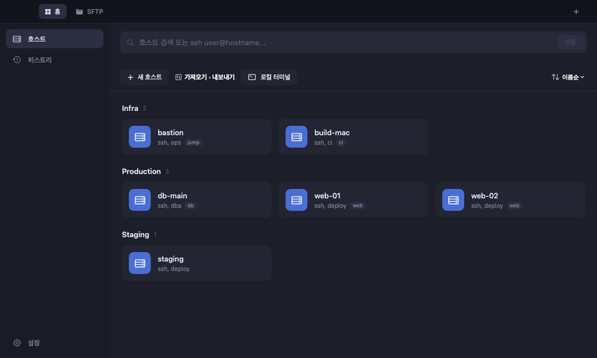

# MyTerminal

[](https://github.com/choiseungyun/MyTerminal/actions/workflows/ci.yml)

**SSH 접속 관리와 SFTP, 화면 분할, AI 도우미를 갖춘 macOS 터미널.** 터미널 엔진은 [Ghostty](https://github.com/ghostty-org/ghostty)의 libghostty 를 쓰고, 그 위의 화면은 직접 설계했습니다.

*A macOS terminal with SSH host management, SFTP, split panes and an AI assistant, built on libghostty. The UI and docs are in Korean.*



## 기능

| | |
| --- | --- |
| **접속 목록** | 호스트 저장·편집(오른쪽 패널), 그룹·태그·검색, `~/.ssh/config` 가져오기, 내보내기·가져오기(비밀번호 제외), 비밀번호 자동 입력(키체인), 저장된 호스트를 경유하는 점프 호스트 |
| **접속 이력** | SSH·SFTP 접속 시작·끝 기록, 다시 접속, 빠른 연결을 호스트로 저장 |
| **화면 분할** | ⌘D·⇧⌘D 로 나눌 때 대상 고르기(같은 서버·로컬·저장된 호스트·`user@host`), 탭을 끌어 다른 탭과 합치기, 새 탭으로 분리, 서버별 색 구분 |
| **SFTP** | 터미널 옆 파일 패널(⌥⌘F), 이 Mac ↔ 서버 두 칸 SFTP 탭, 끌어 놓기 전송·진행률, 원격 파일 편집(저장하면 자동 업로드, 충돌 감지) |
| **AI 도우미** | ⌘K 명령 추천, 선택한 출력·실패한 명령 설명(⇧⌘E), SSH 접속 실패 진단. Claude · ChatGPT · Gemini · EXAONE 중 선택 |
| **터미널** | 한글 입력, 앱 모양(시스템·라이트·다크), 터미널 테마 819개, 글꼴·커서·Option 키 설정, 연결 재사용(같은 서버 화면은 바로 열림) |

AI 도우미는 각자의 API 키를 넣어 씁니다(BYOK). 비밀번호·토큰으로 보이는 문자열은 보내기 전에 가리고, 보낼 내용을 먼저 보여 주며, 제안한 명령은 입력줄에만 넣고 **자동으로 실행하지 않습니다**.

## 설치

[Releases](../../releases) 에서 `MyTerminal-<버전>.dmg` 를 받아 Applications 로 끌어 넣습니다.

- macOS 14 (Sonoma) 이상, Apple Silicon · Intel
- 0.1.2 부터 **자동 업데이트**: 새 버전이 나오면 알려 주고 설치합니다 (앱 메뉴 > 업데이트 확인…, 설정 > 업데이트). 0.1.0·0.1.1 은 0.1.2 를 한 번 직접 받아 주세요.
- Mac App Store 에는 없습니다. 터미널은 셸과 `ssh` 를 실행해야 해서 앱 샌드박스를 쓸 수 없기 때문입니다 ([ADR 0005](docs/decisions/0005-direct-distribution.md)).

## 빌드

필요: macOS 14 이상, Xcode 26 이상, Homebrew

```sh
git clone --recurse-submodules https://github.com/choiseungyun/MyTerminal.git
cd MyTerminal
brew install zig xcodegen                           # Zig 0.17 이상
xcodebuild -downloadComponent MetalToolchain        # 처음 한 번
scripts/build-ghosttykit.sh                         # 엔진 빌드(arm64+x86_64) + 리소스 복사 (약 8분, --native 는 이 Mac 만)
xcodegen generate                                   # MyTerminal.xcodeproj 생성
open MyTerminal.xcodeproj                           # Xcode 에서 실행 (⌘R)
```

명령줄로 빌드·테스트하려면:

```sh
xcodebuild -project MyTerminal.xcodeproj -scheme MyTerminal -derivedDataPath build/DerivedData build
xcodebuild -project MyTerminal.xcodeproj -scheme MyTerminal -destination 'platform=macOS' -derivedDataPath build/DerivedData test
open build/DerivedData/Build/Products/Debug/MyTerminal.app
```

### 코드 서명

기본은 임시 서명이라 Apple 개발자 계정 없이 빌드됩니다. 자기 팀으로 서명하려면(빌드할 때마다 키체인 접근을 다시 묻지 않게 됨):

```sh
cp Config/Signing.local.xcconfig.example Config/Signing.local.xcconfig   # 팀 ID 를 넣는다 (git 에 올리지 않음)
xcodegen generate
```

### 배포 파일 만들기

Developer ID 서명 → 공증 → DMG → 자동 업데이트 목록(`appcast.xml`)은 [`scripts/release.sh`](scripts/release.sh) 가 합니다. 사전 준비는 스크립트 머리 주석에 있습니다.

```sh
scripts/release.sh                 # 서명 + 공증 + 스테이플 → build/release/MyTerminal-<버전>.dmg
scripts/release.sh --adhoc         # 인증서 없이 패키징만 확인
```

## 폴더 구조

| 폴더 | 용도 |
| --- | --- |
| [docs/](docs/README.md) | 계획서, 기능·UI 설계, 결정 기록(ADR), [진행 현황](docs/progress.md) |
| [Sources/](Sources/README.md) | 앱 소스 코드 (Swift, SwiftUI + AppKit) |
| [Tests/](Tests/README.md) | 단위·통합 테스트 |
| [scripts/](scripts/README.md) | 엔진 빌드, 릴리스, 개발 환경 스크립트 |
| [vendor/](vendor/README.md) | 외부 소스 (Ghostty 서브모듈) |
| `Resources/` | 앱 리소스 (터미널 기본 설정, 앱 아이콘) |
| `Config/` | 코드 서명 설정 (공용 `Signing.xcconfig`, 개인 `Signing.local.xcconfig` 는 git 제외) |
| `project.yml` | Xcode 프로젝트 정의 (XcodeGen) |

## 기여

버그 신고·제안·PR 을 환영합니다. [CONTRIBUTING.md](CONTRIBUTING.md) 를 봐 주세요. 보안 문제는 [SECURITY.md](SECURITY.md) 의 방법으로 알려 주세요.

## 라이선스

[MIT](LICENSE). 함께 포함된 Ghostty(MIT), GRDB.swift(MIT), Sparkle(MIT), 글꼴·테마의 고지는 [THIRD_PARTY_NOTICES.md](THIRD_PARTY_NOTICES.md) 에 있습니다 (앱의 도움말 > 오픈소스 라이선스).

MyTerminal 은 Ghostty 프로젝트와 관계가 없으며, Ghostty 프로젝트가 보증하거나 지원하지 않습니다.
